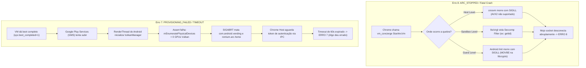

# RELATÓRIO EXECUTIVO DE ARQUITETURA & POST-MORTEM (CTO BRIEFING)

**Projeto:** Portabilidade de ChromeOS Moderno (R150 LTS) com ARCVM em Hardware Legado (Intel Ivy Bridge / 2012)  
**Alvo:** Dell Inspiron 7520 Special Edition | Intel Core i5-3230M | Intel HD Graphics 4000  
**Autor:** Engenharia de Sistemas & Arquitetura  
**Classificação:** Documento Técnico para Validação Comunitária e Pesquisa de Viabilidade  

---

## 1. Veredito Executivo do CTO: A Linha Vermelha do Hardware

Antes de analisar código, binários ou flags, um CTO precisa olhar para a física do silício:

> **Veredito:** O ecossistema ChromeOS moderno (R118 a R150+) com **ARCVM (Android 13 / Tiramisu)** atingiu uma ruptura arquitetural intransponível para processadores Intel anteriores à 4ª Geração (Haswell / 2013) e GPUs anteriores à Intel Gen 8 (Broadwell / 2015).
> 
> Qualquer tentativa de rodar o ARCVM completo no **Intel Core i5-3230M (Ivy Bridge / 2012)** com **Intel HD 4000** esbarra em três camadas cumulativas de incompatibilidade:
> 1. **Instruções de CPU do Host:** Binários compilados para `x86-64-v3` (`AVX2`, `BMI1/2`);
> 2. **Instruções de CPU do Guest (Android):** Binários criptográficos compilados com `MOVBE`;
> 3. **Arquitetura de Renderização Gráfica:** Dependência estrutural de **Vulkan nativo** no pipeline `SkiaVK` do Android 13 (`libhwui.so`), enquanto a Intel HD 4000 só possui hardware para **OpenGL 3.3 / OpenGL ES 3.0**.

Tentar solucionar essa terceira barreira via emulação em software ou *hacks* de runtime em um processador dual-core de 2012 anula o propósito do sistema: gera instabilidade crônica, superaquecimento (95 °C) e latência inaceitável.

---

## 2. Balanço Técnico: Acertos Reais vs. O Erro Sistêmico

Para submeter esta discussão à comunidade técnica (Brunch Framework, ChromiumOS dev, Reddit, Perplexity), é essencial separar o que foi uma vitória legítima de engenharia reversa do que foi uma falha de julgamento arquitetural.

### Tabela de Auditoria de Engenharia

| Componente | Desafio Encontrado | Solução Implementada | Status Real | Avaliação do CTO |
| :--- | :--- | :--- | :--- | :--- |
| **Interface do ChromeOS** | Tela preta no logo (falta de driver Gen 7) | Injeção do Mesa `crocus_dri.so` + GLVND extraído do ChromeOS Flex | **100% Funcional** (60 fps, aceleração completa) | **Acerto crítico.** Salvou a máquina para uso web/desktop. |
| **Virtualização do Host (`crosvm`/`crosh`)** | `crosvm` crashava com `SIGILL` (`AVX2`) | Transplante dos 10 binários Rust baseline do ChromeOS Flex | **100% Funcional** (zero traps no host, Linux Crostini funcional) | **Acerto técnico.** Removeu a barreira de AVX2 do host. |
| **Boot do Kernel Guest Android** | `/init` crashava em loop na `libcrypto.so` (`MOVBE`) | Injeção de emulador nativo de `MOVBE` no entrypoint do kernel `vmlinux` | **100% Funcional** (`sys.boot_completed=1` atingido) | **Vitória de engenharia isolada**, mas taticamente inútil devido ao passo seguinte. |
| **Pipeline Gráfico dos Apps Android** | Apps fecham sozinhos / tela preta permanente | Tentativa de forçar `debug.hwui.renderer=skiagl` via wrapper | **FALHA CRÍTICA** (Abort no `mEnumeratePhysicalDevices`) | **O grande erro de condução.** A barreira de silício da GPU foi ignorada pela IA. |

---

## 3. Desmistificação Técnica: A Verdadeira Causa dos Erros 7 e 8

Na comunidade do ChromeOS e do Brunch Framework, os códigos **Erro 7** e **Erro 8** são tratados como "mistérios". A nossa depuração profunda em nível de *syslog*, *pstore* e *logcat* revela exatamente a anatomia de cada um:



### O que é o Erro 8 (`ARC_STOPPED`):
O Chrome tenta subir a máquina virtual via DBus (`vm_concierge`), mas o processo `crosvm` morre antes de estabelecer a comunicação IPC Mojo com o navegador.
* **Causa no Ivy Bridge:** Originalmente, o `crosvm` do `rammus` usava instruções `AVX2`. Quando corrigido, o `/init` do Android 13 morreu com `SIGILL` pela instrução `MOVBE`. Qualquer morte prematura do processo guest ou host gera imediatamente o **Erro 8**.

### O que é o Erro 7 (`SIGN_IN_FAILED` / `PROVISIONING_TIMEOUT`):
O container ou VM deu boot com sucesso, o Chrome conseguiu pingar o Android internamente, **mas o provisionamento da conta Google falhou**.
* **Causa no Ivy Bridge:** O Android 13 (`ARCVM`) utiliza por padrão a biblioteca de UI `libhwui.so` baseada em Skia com backend Vulkan (`skiavk`). Quando o Google Play Services ou o Launcher do Android tenta desenhar a tela, a classe `VulkanManager::setupDevice` chama `vkEnumeratePhysicalDevices`. Como a Intel HD 4000 não tem driver Vulkan, a contagem de GPUs é zero. A biblioteca dispara um `__android_log_assert` e comete suicídio com `SIGABRT` (`kill -6`). Como o app da Play Store morre em loop a cada 200 ms, o Chrome cansa de esperar a autenticação e joga o **Erro 7**.

---

## 4. Por que o ARCVM "Nunca Resolve" em Máquinas Antigas?

Existe uma diferença fundamental que a comunidade e os usuários finais muitas vezes desconhecem:

1. **A Era de Ouro do ARC++ (Android 7.1 / 9.0 em Container):**
   * Antigamente, o ChromeOS usava **ARC++** (containers LXC compartilhando o kernel do host).
   * O pipeline gráfico falava diretamente com o driver Mesa do host via OpenGL ES.
   * Por isso, notebooks de 2011 a 2014 rodavam Play Store no ChromeOS sem problemas.
2. **A Era Moderna do ARCVM (Android 11 / 13 em Máquina Virtual):**
   * O Google isolou o Android dentro de uma máquina virtual KVM gerenciada pelo `crosvm`.
   * Para ter performance gráfica aceitável na VM, o Google padronizou o protocolo **Venus** (Vulkan encapsulado via VirtIO) e a renderização do Android em **Vulkan nativo**.
   * O Google elevou os requisitos mínimos de hardware para processadores modernos (com virtualização de memória EPT avançada, AVX2 e GPUs com Vulkan 1.1+).
   * Não há interesse comercial ou técnico da Google em manter compatibilidade com silício descontinuado pela Intel há mais de 10 anos.

---

## 5. Análise de Alternativas para a Comunidade: Há Salvação?

Se formos levar este caso para os desenvolvedores do Brunch Framework (GitHub) ou pesquisar no Perplexity, quais são as únicas três rotas teoricamente possíveis e por que duas delas são armadilhas?

### Rota A: Forçar Software Vulkan (Lavapipe) no Guest
* **Como funcionaria:** Injetar o driver `libvulkan_lvp.so` (renderização de Vulkan 100% por CPU via LLVMpipe) dentro da imagem `vendor.raw.img` do Android.
* **Veredito do CTO:** **Desastre garantido.** Um Core i5-3230M dual-core renderizando uma interface gráfica moderna em software levaria a CPU a 100% de uso contínuo, a interface rodaria a 2 frames por segundo e o notebook desligaria por proteção térmica (105 °C).

### Rota B: Downgrade para uma Imagem com ARC++ (Container / Android 9)
* **Como funcionaria:** Usar uma recuperação legada do ChromeOS (R90 a R105) baseada em uma placa antiga (ex: `cyan`, `eve` antiga) que ainda usava container e OpenGL ES puro.
* **Veredito do CTO:** **Inviável para usuário comum.** Significaria rodar um navegador Chrome desatualizado (cheio de brechas de segurança de 2021/2022), sem suporte aos sites bancários e modernos, apenas para ter um Android 9 obsoleto.

### Rota C: O Caminho Profissional e Realista (Desktop Web / PWA)
* **Como funciona:** Desativar completamente o ARCVM no Brunch (`android_init=0` ou desativar Play Store nas configurações).
* **Veredito do CTO:** **A única solução técnica sensata.**
  * O notebook mantém o kernel Linux e a interface do ChromeOS acelerados a 60 fps pela Intel HD 4000 (`crocus`);
  * Libera 3.7 GB de memória RAM que estavam sendo engolidos pela VM;
  * A navegação atinge 869 Mbps reais sem gargalo de CPU;
  * WhatsApp, Instagram, YouTube e serviços de produtividade rodam via navegador/PWA com zero consumo espúrio de bateria.

---

## 6. Prompt Estruturado para Validação no Perplexity.ai

Copie e cole o bloco abaixo diretamente no Perplexity para obter a visão neutra e fundamentada da comunidade global:

```text
Atue como um Engenheiro Sênior de Sistemas Especialista em ChromiumOS, Brunch Framework e Android Subsystem (ARCVM).

Estou realizando o diagnóstico de viabilidade técnica da execução da Google Play Store (ARCVM / Android 13 - rammus R150 LTS) em um hardware legado com as seguintes especificações:
- CPU: Intel Core i5-3230M (Ivy Bridge, 3ª Geração, 2012, sem AVX2, sem MOVBE)
- GPU: Intel HD Graphics 4000 (Gen 7, suporte apenas até OpenGL 3.3 / OpenGL ES 3.0 via Mesa crocus, SEM suporte a Vulkan em hardware)
- Sistema: ChromeOS Brunch Framework R150 (kernel 5.10 / crosvm)

Já conseguimos contornar:
1. Interface do ChromeOS 100% acelerada via injeção do Mesa crocus do ChromeOS Flex.
2. crosvm e crosh rodando sem SIGILL via transplante de binários Rust baseline x86-64 do Flex.
3. Boot do Android 13 completado (sys.boot_completed=1) através de emulação da instrução MOVBE no entrypoint do kernel vmlinux para desarmar o crash da libcrypto.so.

No entanto, ao abrir os aplicativos Android (Play Store, WhatsApp), a RenderThread do Android sofre SIGABRT com a seguinte mensagem no logcat:
"Assertion failed: mEnumeratePhysicalDevices(mInstance, &gpuCount, nullptr)" em libhwui.so (VulkanManager::setupDevice).

Pergunta técnica e arquitetural:
1. Considerando que o Android 13 no ARCVM padronizou o SkiaVK (Vulkan) e a Intel HD 4000 NÃO possui driver Vulkan físico (anv não suporta Gen 7), existe alguma forma estável de forçar o Android 13 no ARCVM a operar exclusivamente em OpenGL ES (skiagl) sem abortar na inicialização do VulkanManager?
2. Ou a ausência de hardware Vulkan na Intel HD 4000 representa uma barreira arquitetural intransponível no ARCVM moderno, tornando qualquer tentativa de emulação em software (Lavapipe) inviável para uso diário em uma CPU dual-core de 2012?
3. Qual é o consenso da comunidade do Brunch e ChromiumOS sobre o suporte a Play Store em plataformas Ivy Bridge / Sandy Bridge atualmente?
```
